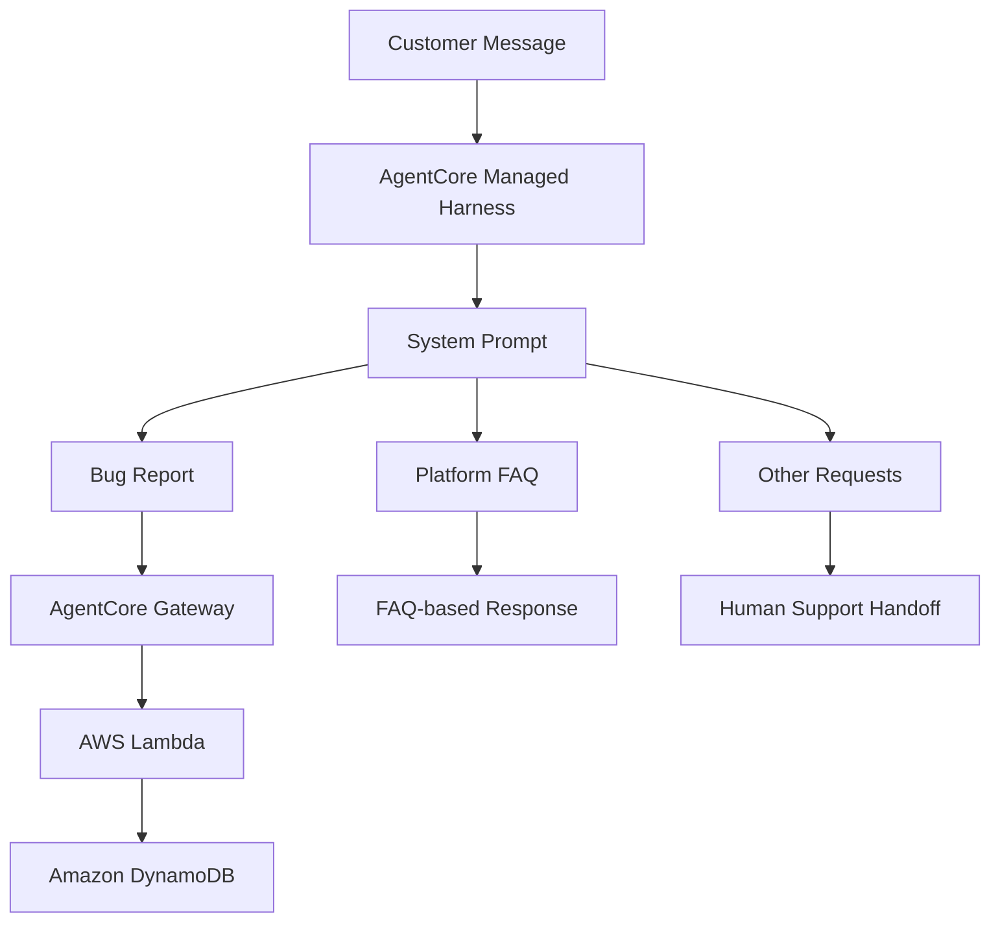

🌐 Language: English | [繁體中文](README_zh-TW.md)

# Customer Support Chatbot with Amazon Bedrock AgentCore

A hands-on AWS AI Agent project built as part of the Udacity AWS AI Agent Nanodegree.

This project demonstrates how to build a customer support chatbot using **Amazon Bedrock AgentCore Managed Harness**, with prompt-based intent routing, multi-turn information collection, tool integration, and automated LLM evaluation.

## Project Overview

The chatbot handles customer messages for a fictional online store and routes them into three categories:

- **Bug Reports:** Collects required information through multi-turn conversations and submits completed reports using an integrated tool.
- **Platform Questions:** Answers questions about orders, shipping, returns, and payments using an embedded FAQ.
- **Other Requests:** Politely redirects customers to human support.

The routing logic is implemented through a single system prompt. The AgentCore managed harness provides the agent execution loop, stateful sessions, and tool execution. No separate classifier or conditional routing nodes are used.

## Architecture

### Bug Report Workflow

The agent collects three required fields:

1. Description — the customer's description of the issue.
2. Steps to Reproduce — the actions that trigger the issue.
3. Environment — the browser, operating system, or device.

The agent asks for missing information one field at a time. Once all required fields are available, it invokes the `create_bug_report` tool through AgentCore Gateway.

The Lambda function stores the submitted report in Amazon DynamoDB and returns a ticket ID to the customer.

## Technology Stack

| Technology | Purpose |
|---|---|
| Python | Project scripts and Lambda implementation |
| Amazon Bedrock | LLM inference |
| Amazon Bedrock AgentCore Managed Harness | Agent execution and stateful sessions |
| Amazon Bedrock AgentCore Gateway | Tool integration |
| AWS Lambda | Bug report processing |
| Amazon DynamoDB | Ticket storage |
| AWS CloudFormation | Infrastructure provisioning |
| Amazon Bedrock Evaluations | LLM-as-a-Judge evaluation |

## Key Implementation Areas

### 1. Prompt Engineering and Intent Routing

Refined the system prompt to distinguish among bug reports, platform questions, and other requests.

Improved routing instructions by defining category boundaries and clarifying ambiguous customer scenarios to reduce incorrect classification.

### 2. Multi-turn Information Collection

Designed conversation rules to collect the three required bug report fields.

- Identify missing information.
- Ask for one missing field at a time.
- Avoid submitting incomplete reports.
- Invoke the tool when all required fields have been collected.

### 3. Tool Integration

Worked with the provided AgentCore Gateway and AWS Lambda integration to connect the chatbot with the bug report submission workflow.

Bug report data is stored in Amazon DynamoDB, and the chatbot returns the generated ticket ID.

### 4. FAQ Grounding

Refined prompt instructions to ensure platform-related answers are grounded in the embedded FAQ.

The chatbot should not invent unsupported policies, prices, or service information. When the FAQ does not contain an answer, it should communicate the limitation and direct the customer to human support.

### 5. Evaluation and Iterative Improvement

Developed test cases covering the three routing categories, incomplete bug reports, ambiguous requests, and other edge cases.

Used Amazon Bedrock Evaluations with an LLM-as-a-Judge evaluation approach to assess response correctness.

Analyzed evaluation results and iteratively refined the system prompt to improve routing consistency and response quality.

### 6. AgentCore Harness Configuration

Adjusted the provided harness creation script to disable session memory for evaluation, helping isolate test cases and reduce unintended context carryover between evaluation sessions.

## Project Scope and Contributions

This project was completed using Udacity-provided starter code and infrastructure templates.

My work focused on implementing and refining the assigned prompt-engineering and evaluation requirements, including:

- System prompt refinement and intent-routing rules.
- Multi-turn bug report information collection.
- Tool invocation conditions and response behavior.
- Evaluation test case development.
- Evaluation result analysis and prompt iteration.
- AgentCore harness configuration for isolated evaluation sessions.

The underlying infrastructure and starter implementation were provided as part of the course.

## Project Status

This was a cloud-based training and implementation project.

The AWS resources used during development and evaluation have been decommissioned after project completion to avoid ongoing cloud costs. Therefore, a live chatbot endpoint is not currently available.

The repository is retained as a record of the project implementation, configuration, and learning outcomes.

## Learning Outcomes

Through this project, I gained hands-on experience with:

- Designing prompt-driven AI Agent workflows.
- Managing multi-turn conversations with stateful agent sessions.
- Integrating LLM agents with external tools through AgentCore Gateway.
- Connecting AWS Lambda and DynamoDB in an AI Agent workflow.
- Grounding LLM responses in reference documents.
- Evaluating and iteratively improving agent behavior using LLM-as-a-Judge.

---

**Project Type:** Udacity AWS AI Agent Nanodegree — Hands-on Training Project  
**Focus:** Prompt Engineering · AI Agent Tool Integration · AWS · LLM Evaluation
