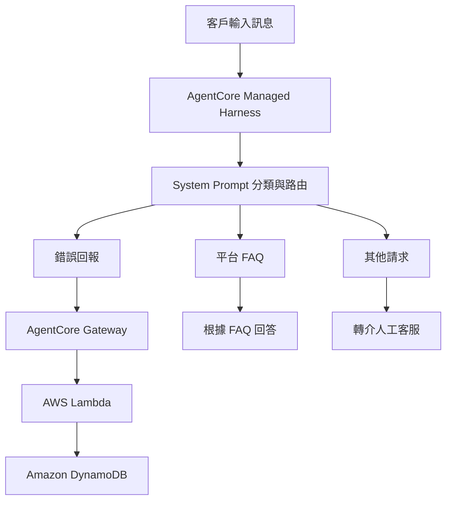

🌐 語言：[English](README.md) | 繁體中文

# 使用 Amazon Bedrock AgentCore 建置 AI 客服聊天機器人

本專案是 Udacity AWS AI Agent Nanodegree 課程中的實作專案，使用 **Amazon Bedrock AgentCore Managed Harness** 建置 AI 客服聊天機器人。

專案涵蓋 Prompt Engineering、多輪對話資訊蒐集、外部工具整合，以及使用大型語言模型評估客服 Agent 的回答品質。

## 專案概述

本專案以虛構的線上商店為情境，設計一個能夠根據客戶訊息，自動判斷需求並採取適當回應的 AI 客服 Agent。

系統將客戶訊息分為三種類型：

- **錯誤回報（Bug Reports）：** 透過多輪對話蒐集問題資訊，完成必要欄位後，呼叫工具建立錯誤回報紀錄。
- **平台相關問題（Platform Questions）：** 根據內嵌於 System Prompt 的 FAQ，回答訂單、配送、退貨及付款等常見問題。
- **其他請求（Other Requests）：** 禮貌地引導客戶聯繫人工客服。

本專案的核心是透過單一 System Prompt 設計訊息分類、資訊蒐集與回應規則。

AgentCore Managed Harness 負責提供 Agent 執行流程、狀態式對話 Session 與工具執行能力；Agent 的實際行為則由 System Prompt 定義。

系統沒有使用獨立的分類器或條件式流程節點。

## 系統架構

### 錯誤回報處理流程

當客戶回報系統錯誤時，Agent 必須透過多輪對話蒐集以下三項必要資訊：

1. **Description（問題描述）：** 客戶使用自己的文字描述遇到的問題。
2. **Steps to Reproduce（重現步驟）：** 能夠觸發問題的操作過程。
3. **Environment（執行環境）：** 發生問題時使用的瀏覽器、作業系統或裝置。

Agent 會檢查目前已取得的資訊，逐一詢問尚未提供的欄位。

當三項必要資訊都完整後，Agent 透過 AgentCore Gateway 呼叫 `create_bug_report` 工具。

此工具由 AWS Lambda 執行，將錯誤回報資料儲存至 Amazon DynamoDB，並將產生的 Ticket ID 回傳給客戶。

## 使用技術

| 技術 | 用途 |
|---|---|
| Python | 專案腳本與 Lambda 程式 |
| Amazon Bedrock | 提供大型語言模型推論服務 |
| AgentCore Managed Harness | Agent 執行環境與狀態式對話管理 |
| AgentCore Gateway | 將外部工具整合至 Agent |
| AWS Lambda | 處理錯誤回報資料 |
| Amazon DynamoDB | 儲存錯誤回報紀錄 |
| AWS CloudFormation | 部署 AWS 基礎設施 |
| Amazon Bedrock Evaluations | 使用 LLM-as-a-Judge 評估回答品質 |

## 主要實作內容

### 1. Prompt Engineering 與訊息分類

調整 System Prompt，使 Agent 能夠辨識三種不同的客服需求：

- 錯誤回報
- 平台常見問題
- 其他非上述類型的請求

透過明確定義分類條件與容易混淆的情境，改善 Agent 的分類一致性與回應行為。

### 2. 多輪對話資訊蒐集

設計錯誤回報的資訊蒐集規則：

- 確認目前已取得的必要資訊。
- 一次詢問一項缺漏欄位。
- 避免在資訊不完整時提交錯誤回報。
- 確認三項必要資訊完整後才呼叫工具。

### 3. 外部工具整合

使用課程提供的 AgentCore Gateway 與 AWS Lambda 整合架構，讓 Agent 能夠執行錯誤回報提交流程。

透過 Lambda 將錯誤回報資料寫入 Amazon DynamoDB，並將 Ticket ID 回傳給 Agent。

### 4. FAQ 知識依據與回答限制

調整 Prompt 中的 FAQ 回答規則，要求 Agent 根據提供的 FAQ 回答平台相關問題。

當 FAQ 沒有提供足夠資訊時，Agent 不應自行推測政策、價格或服務內容，而應清楚告知資訊不足並引導客戶聯繫人工客服。

### 5. 自動化測試與評估優化

設計涵蓋三種客服情境的測試案例，並加入資訊不完整、模糊請求及其他邊界情境。

使用 Amazon Bedrock Evaluations 搭配 LLM-as-a-Judge 評估方式，檢視 Agent 的回答正確性。

根據個別測試案例的評估結果，反覆調整 System Prompt，以改善訊息分類一致性及回應品質。

### 6. AgentCore Harness 設定調整

修改課程提供的 Harness 建立腳本，停用評估期間的 Session Memory，以降低不同測試案例之間的對話上下文干擾，讓測試結果更具獨立性。

## 專案實作範圍與個人貢獻

本專案使用 Udacity 提供的 Starter Code 與基礎設施範本完成。

個人實作與調整重點包括：

- System Prompt 的設計與優化。
- 客服訊息分類及模糊情境處理規則。
- 多輪錯誤回報資訊蒐集流程。
- 工具呼叫條件與回應行為調整。
- 評估測試案例設計與擴充。
- Bedrock Evaluation 結果分析與 Prompt 迭代。
- AgentCore Harness 評估設定調整。

底層基礎設施與部分初始程式碼由課程提供，本專案主要著重於指定功能的實作、調整與測試。

## 專案狀態

本專案屬於雲端環境中的 AI Agent 訓練與實作專案。

開發與測試期間使用的 AWS 資源已於專案完成後關閉，以避免持續產生雲端費用。

因此，目前沒有提供可直接使用的線上客服服務或即時 Demo。

此 Repository 保留專案實作、設定及學習成果，供技術展示與參考。

## 學習成果

透過本專案，實際接觸並練習以下技術與概念：

- 使用 Prompt Engineering 設計 AI Agent 工作流程。
- 使用狀態式 Session 管理多輪對話。
- 透過 AgentCore Gateway 整合外部工具。
- 整合 AWS Lambda 與 DynamoDB，建立錯誤回報流程。
- 使用參考文件限制 LLM 的回答範圍。
- 使用 LLM-as-a-Judge 評估並迭代改善 Agent 行為。

---

**專案類型：** Udacity AWS AI Agent Nanodegree 課程實作專案

**技術重點：** Prompt Engineering · AI Agent Tool Integration · AWS · LLM Evaluation
